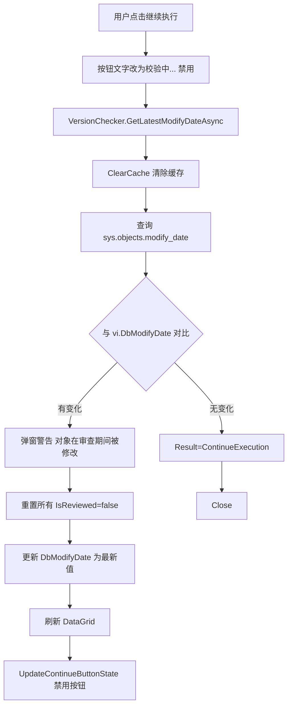

## 产品概述

针对版本守卫弹窗审查期间的并发竞态问题：用户A在审查差异时，用户B可能更新了服务器脚本，导致用户A审查的DB版本已过时。需要在点击"继续执行"时进行二次校验，确保审查结果仍然有效。

## 核心功能

- **二次 modify_date 校验**：点击"继续执行"时，对每个过时对象重新查询 `modify_date`，与弹窗打开时记录的 `DbModifyDate` 对比
- **检测到变化时重置审查**：弹窗提示"以下对象在审查期间被修改"，重置所有对象的 `IsReviewed` 状态，要求用户重新审查
- **每次都校验**：不设时间阈值，安全优先
- **校验期间 UI 反馈**：按钮文字变为"校验中..."并禁用，防止重复点击

## Tech Stack

- WPF + XAML（net472，SSMS 扩展宿主层）
- C# 10.0 + Nullable enable
- 复用现有 `IDatabaseService.GetObjectModifyDateAsync` 接口
- 复用现有 `DatabaseService.ClearCache()` 机制

## Implementation Approach

### 核心策略

在 `VersionChecker` 中新增 `GetLatestModifyDateAsync` 方法（内部先 `ClearCache()` 再查询，确保获取的是数据库最新值而非缓存），通过回调注入 `VersionWarningDialog`。`ContinueExecution_Click` 改为 async，点击时先逐个查询最新 `modify_date`，与 `vi.DbModifyDate` 对比，有变化则警告并重置审查状态。

### 关键技术决策

1. **ClearCache 时机**：`DatabaseService` 有 5 分钟 TTL 缓存（`_cacheTtl = TimeSpan.FromMinutes(5)`），审查期间缓存不会自动过期。因此 `GetLatestModifyDateAsync` 内部必须先调用 `_databaseService.ClearCache()` 再查询，否则二次校验拿到的仍是缓存中的旧值，校验无意义。

2. **modify_date 变化判定**：使用 `!=` 比较 `DateTime?`。若新值为 null（对象被删除）也视为变化，触发警告。

3. **查询失败处理**：安全优先原则下，任一对象查询失败则弹窗报错，不允许继续执行。避免因网络抖动跳过校验。

4. **UI 反馈方式**：不弹出 ProcessingDialog（modify_date 查询通常 <500ms），仅通过按钮文字"校验中..."+ 禁用提供反馈，保持交互轻量。

5. **重置策略**：检测到任一对象变化时，重置**所有**对象的 `IsReviewed = false`（用户确认的选择），并更新 `DbModifyDate` 为最新值，使下一轮审查基于最新数据。

### 性能

- 二次校验为 N 次 `modify_date` 查询（N = 过时对象数，通常 1-5 个），每次单条 SQL 查询 `sys.objects`，总耗时 <1s
- `ClearCache()` 是 O(n) Dictionary 清空操作，n 通常 <10，可忽略

### 向后兼容

- `IDialogService.ShowVersionWarningDialog` 新增参数为纯增量，无 mock 测试引用此接口，不影响现有测试
- `VersionWarningResult` 枚举不变，调用方 switch 逻辑无需修改
- `VersionChecker.GetLatestModifyDateAsync` 为新增方法，不影响现有方法

## Architecture Design



## Directory Structure

```
src/
├── Core/
│   └── VersionGuard/
│       └── VersionChecker.cs              # [MODIFY] 新增 GetLatestModifyDateAsync 方法（含 ClearCache）
├── Core/
│   └── Interfaces/
│       └── IDialogService.cs              # [MODIFY] ShowVersionWarningDialog 新增 getLatestModifyDate 参数
├── SSMS/
│   ├── Services/
│   │   ├── SsmsDialogService.cs           # [MODIFY] 传递新参数到 VersionWarningDialog 构造函数
│   │   └── ExecutionInterceptor.cs        # [MODIFY] 调用处提供 getLatestModifyDate 回调
│   ├── Commands/
│   │   └── VersionGuardCommand.cs         # [MODIFY] 调用处提供 getLatestModifyDate 回调
│   └── UI/Dialogs/
│       └── VersionWarningDialog.xaml.cs   # [MODIFY] 构造函数接收新参数，ContinueExecution_Click 改为 async 二次校验
```

### 文件修改详情

#### `src/Core/VersionGuard/VersionChecker.cs` [MODIFY]

- **Purpose**: 提供获取最新 modify_date 的能力
- **Changes**: 新增 `GetLatestModifyDateAsync(connectionString, database, schema, name)` 方法，内部先调用 `_databaseService.ClearCache()` 清除缓存，再调用 `GetObjectModifyDateAsync` 获取最新值。异常时返回 null 并记录日志。

#### `src/Core/Interfaces/IDialogService.cs` [MODIFY]

- **Purpose**: 接口签名增加二次校验回调
- **Changes**: `ShowVersionWarningDialog` 方法新增第 4 个参数 `Func<VersionInfo, Task<DateTime?>> getLatestModifyDate`

#### `src/SSMS/Services/SsmsDialogService.cs` [MODIFY]

- **Purpose**: 传递新参数
- **Changes**: `ShowVersionWarningDialog` 实现接收 `getLatestModifyDate` 并传递给 `VersionWarningDialog` 构造函数

#### `src/SSMS/UI/Dialogs/VersionWarningDialog.xaml.cs` [MODIFY]

- **Purpose**: 实现二次校验逻辑
- **Changes**:
- 新增 `_getLatestModifyDate` 私有字段
- 构造函数新增 `getLatestModifyDate` 参数
- `ContinueExecution_Click` 改为 `async void`：
    - 保存按钮原始文字，改为"校验中..."，禁用按钮
    - 遍历所有过时对象，调用 `_getLatestModifyDate(vi)` 获取最新 modify_date
    - 与 `vi.DbModifyDate` 对比（null 也视为变化）
    - 有变化：弹窗警告列出变化的对象名，重置所有 `IsReviewed=false`，更新 `DbModifyDate` 为最新值，刷新 DataGrid，`UpdateContinueButtonState()`
    - 无变化：`Result=ContinueExecution`，`Close()`
    - finally 块恢复按钮文字

#### `src/SSMS/Services/ExecutionInterceptor.cs` [MODIFY]

- **Purpose**: 提供二次校验回调
- **Changes**: `ShowVersionWarningDialog` 调用新增第 4 个参数 `vi => versionChecker.GetLatestModifyDateAsync(connectionString!, vi.ObjectRef.Database ?? database ?? "dbo", vi.ObjectRef.Schema, vi.ObjectRef.Name)`

#### `src/SSMS/Commands/VersionGuardCommand.cs` [MODIFY]

- **Purpose**: 提供二次校验回调
- **Changes**: `ShowVersionWarningDialog` 调用新增第 4 个参数，与 ExecutionInterceptor 相同模式

## 边缘情况与异常处理

| 场景 | 处理方式 |
|------|----------|
| 对象在审查期间被删除 | `modify_date` 查询返回 null，视为变化，触发警告 |
| 网络抖动导致查询失败 | 安全优先，弹窗报错，不允许继续执行 |
| 多个对象同时变化 | 列出所有变化的对象名，一次性重置所有审查状态 |
| 校验通过后用户再次点击 | 按钮已恢复可用，重新走完整校验流程 |
| 弹窗打开期间对象未被修改 | modify_date 一致，正常关闭弹窗继续执行 |
