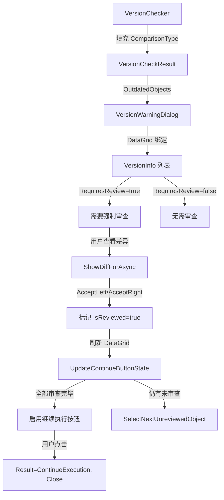

## 用户需求

优化 `VersionWarningDialog` 中"继续执行"按钮的逻辑，强制要求存在差异的对象必须先完成差异比对审查后才能继续执行。

## 产品概述

当前版本守卫弹窗允许用户直接点击"继续执行"跳过所有差异比对，存在数据安全风险。优化后，弹窗将强制用户审查所有有实际差异的对象差异，确保用户在执行前已了解并处理所有版本差异。

## 核心功能

- **强制审查机制**：比对结果为 Conflict、OnlyAdded、OnlyDeleted 的对象必须查看差异后才能继续执行
- **审查状态追踪**：在对象列表中新增"审查状态"列，用颜色标记已审查/待审查/无需审查
- **按钮智能禁用**："继续执行"按钮在存在未审查差异对象时禁用，全部审查完毕后自动启用
- **多对象逐个审查**：审查完一个对象后弹窗保持打开，自动跳转选中下一个未审查对象
- **重新加载确认**：点击"从数据库重新加载"时弹出确认框，提醒用户将丢失本地修改

## 技术栈

- WPF + XAML（net472，SSMS 扩展宿主层）
- C# 10.0 + Nullable enable
- DataGrid 数据绑定 + DataTrigger 样式驱动
- 非模态弹窗模式（Show/Close，非 DialogResult）

## 实现方案

### 核心策略

在 `VersionInfo` 模型上新增 `IsReviewed` 和 `RequiresReview` 属性，驱动 UI 层的按钮启用/禁用逻辑和审查状态可视化。修改 `ShowDiffForAsync` 方法，审查完一个对象后不再关闭弹窗，而是标记已审查、刷新列表、自动选中下一个未审查对象。

### 关键技术决策

1. **不实现 INotifyPropertyChanged**：VersionInfo 当前是纯 POCO，为最小化修改，审查状态变更后调用 `ObjectsGrid.Items.Refresh()` 手动刷新 DataGrid，而非引入 INotifyPropertyChanged 模式
2. **审查状态列使用 DataTrigger**：与现有"比对结果"列的 badge 样式保持一致，复用 `ComparisonBadge` 样式
3. **不修改 AcceptLeft/AcceptRight 的 ReplaceAllAsync 逻辑**：当前 `ReplaceAllAsync(mergedScript)` 会用单个对象的合并脚本替换整个编辑器内容，多对象场景下存在已知限制（后续对象行号会失效）。此问题属于预存 bug，不在本次修改范围内，但会在实现备注中标注
4. **"从数据库重新加载"不加审查门禁**：该操作本身是放弃本地脚本，用户确认后直接执行

### 数据流

```
F5 拦截 → VersionChecker.CheckVersionAsync → PerformQuickComparisonAsync 填充 ComparisonType
→ VersionWarningDialog 显示 → 用户逐个审查差异（标记 IsReviewed=true）
→ 全部 RequiresReview 对象审查完毕 → "继续执行"按钮启用
→ 用户点击"继续执行" → Result=ContinueExecution → ExecutionInterceptor 重新执行 SQL
```

## 实现备注

### 性能

- `ObjectsGrid.Items.Refresh()` 是 O(n) 操作，n = 过时对象数量（通常 1-5个），性能无瓶颈
- `GetUnreviewedObjects()` 使用 LINQ Where 过滤，O(n)，可忽略

### 已知限制（不在本次修改范围）

- **多对象 ReplaceAllAsync 问题**：当脚本包含多个对象定义时，审查第一个对象后 `ReplaceAllAsync(mergedScript)` 会用该对象的合并脚本替换整个编辑器内容，导致后续对象的 `ObjectRef.LineNumber` 失效。单对象场景（最常见）不受影响。后续可通过在 `ObjectExtractor` 中新增 `ReplaceObjectScriptInCode` 方法实现对象级替换来修复
- **AcceptLeft 后续审查的 localScript 来源**：`_currentScriptCode` 更新为合并后脚本后，后续对象的 `ExtractObjectScript` 可能因行号偏移而提取错误内容，会 fallback 到整个 `_currentScriptCode`

### 日志

- 审查状态变更时记录 Debug 日志：`[VersionWarning] Object {FullName} reviewed, {remaining} objects remaining`
- "继续执行"按钮状态变更时记录 Debug 日志

### 向后兼容

- `VersionInfo` 新增属性为纯增量，不影响现有序列化/反序列化
- `VersionWarningResult` 枚举不变，调用方（ExecutionInterceptor、VersionGuardCommand）无需修改
- `SetButtonsEnabled` 方法签名不变，内部逻辑调整

## 架构设计



## 目录结构

```
src/
├── Core/
│   └── VersionGuard/
│       └── Models/
│           └── VersionModels.cs          # [MODIFY] VersionInfo 新增 IsReviewed、RequiresReview、ReviewStatusText 属性
├── SSMS/
│   └── UI/
│       └── Dialogs/
│           ├── VersionWarningDialog.xaml     # [MODIFY] 新增审查状态列、继续执行按钮初始禁用
│           └── VersionWarningDialog.xaml.cs  # [MODIFY] 重构 ShowDiffForAsync、ReloadFromDb_Click、新增辅助方法
tests/
└── SSMSBoostPlus.Tests/
    ├── CoreTests.cs                     # [MODIFY] 新增 RequiresReview、ReviewStatusText 单元测试
    └── ObjectExtractorEdgeTests.cs      # [MODIFY] 新增 RequiresReview 各 ComparisonType 场景测试
```

## 文件修改详情

### `src/Core/VersionGuard/Models/VersionModels.cs` [MODIFY]

- **Purpose**: 为 VersionInfo 增加审查状态追踪能力
- **Changes**:
  - 新增 `IsReviewed` 属性（bool，默认 false）
  - 新增 `RequiresReview` 只读计算属性：当 `ComparisonType` 为 Conflict、OnlyAdded、OnlyDeleted 时返回 true
  - 新增 `ReviewStatusText` 只读计算属性：返回"已审查"/"待审查"/"无需审查"

### `src/SSMS/UI/Dialogs/VersionWarningDialog.xaml` [MODIFY]

- **Purpose**: UI 层展示审查状态，控制按钮初始状态
- **Changes**:
  - 在 DataGrid 中新增"审查状态"列（DataGridTemplateColumn），使用 DataTrigger 根据 `IsReviewed` 和 `RequiresReview` 显示不同颜色 badge
  - "继续执行"按钮添加 `IsEnabled="False"` 初始状态
  - 审查状态 badge 样式：已审查=绿色(#E8F5E9)、待审查=橙色(#FFF3E0)、无需审查=灰色(#F5F5F5)

### `src/SSMS/UI/Dialogs/VersionWarningDialog.xaml.cs` [MODIFY]

- **Purpose**: 重构审查流程逻辑
- **Changes**:
  - 构造函数末尾调用 `UpdateContinueButtonState()` 初始化按钮状态
  - `ShowDiffForAsync` 的 `Closed` 回调中：AcceptLeft/AcceptRight 后不再 `Close()`，改为设置 `vi.IsReviewed = true`、调用 `ObjectsGrid.Items.Refresh()`、`SelectNextUnreviewedObject()`、`UpdateContinueButtonState()`
  - `ReloadFromDb_Click` 增加 `MessageBox.Show` 确认框（YesNo），用户确认后才设置 Result 并 Close
  - `SetButtonsEnabled` 恢复按钮时，"继续执行"按钮的启用状态交由 `UpdateContinueButtonState()` 控制
  - 新增 `UpdateContinueButtonState()`：检查是否所有 `RequiresReview=true` 的对象都已 `IsReviewed=true`，据此启用/禁用"继续执行"按钮
  - 新增 `SelectNextUnreviewedObject()`：在 DataGrid 中选中第一个 `RequiresReview=true && IsReviewed=false` 的对象
  - 新增 `GetUnreviewedObjects()`：LINQ 查询返回待审查对象列表

### `tests/SSMSBoostPlus.Tests/CoreTests.cs` [MODIFY]

- **Purpose**: 验证 RequiresReview 和 ReviewStatusText 逻辑
- **Changes**:
  - 新增测试：`RequiresReview_Conflict_ReturnsTrue`
  - 新增测试：`RequiresReview_OnlyAdded_ReturnsTrue`
  - 新增测试：`RequiresReview_OnlyDeleted_ReturnsTrue`
  - 新增测试：`RequiresReview_Identical_ReturnsFalse`
  - 新增测试：`RequiresReview_NotFound_ReturnsFalse`
  - 新增测试：`ReviewStatusText_Reviewed_ReturnsCorrectText`

### `tests/SSMSBoostPlus.Tests/ObjectExtractorEdgeTests.cs` [MODIFY]

- **Purpose**: 补充 VersionInfo 审查状态边界测试
- **Changes**:
  - 新增测试：`VersionInfo_RequiresReview_Unknown_ReturnsFalse`
  - 新增测试：`VersionInfo_ReviewStatusText_NotReviewed_RequiresReview_Returns待审查`
  - 新增测试：`VersionInfo_ReviewStatusText_NotReviewed_NoReview_Returns无需审查`
