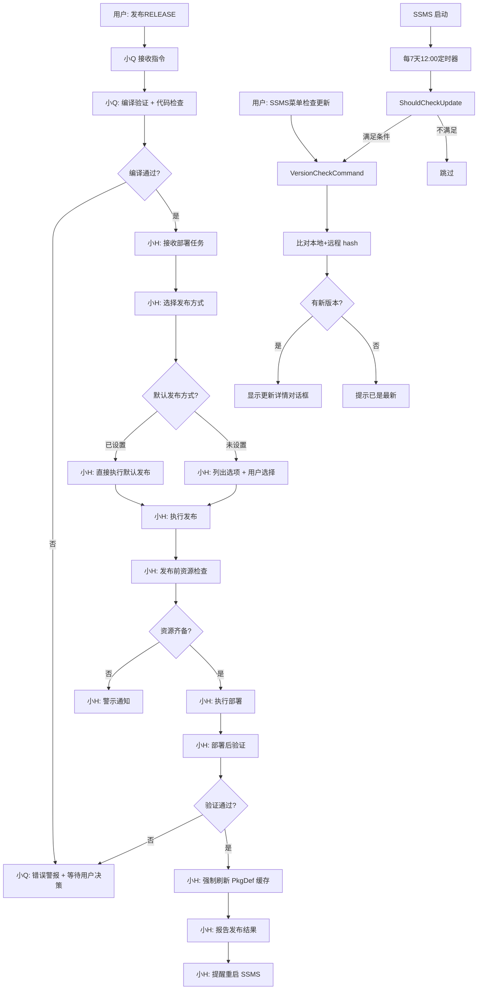
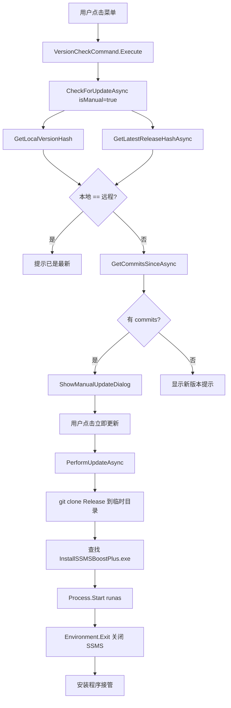

# SSMSBoostPlus 发布 SOP

本文档描述 SSMSBoostPlus 项目的完整发布流程，覆盖**发布**、**版本检查**、**自动更新提示**三大环节。
所有发布操作由 **小H（发布部署 Agent）** 完成，命令入口为用户对 小Q 说"**发布RELEASE**"。

---

## 目录

1. [发布流程总览](#1-发布流程总览)
2. [角色与职责](#2-角色与职责)
3. [前置条件](#3-前置条件)
4. [标准发布流程（SSMSBoostPlus → Release 分支）](#4-标准发布流程ssmsboostplus--release-分支)
5. [手动检查更新（SSMS 菜单触发）](#5-手动检查更新ssms-菜单触发)
6. [每周自动检查更新（SSMS 内部定时器）](#6-每周自动检查更新ssms-内部定时器)
7. [本地与远程版本比对机制](#7-本地与远程版本比对机制)
8. [边缘情况与异常处理](#8-边缘情况与异常处理)
9. [附录：相关文件与命令参考](#9-附录相关文件与命令参考)

---

## 1. 发布流程总览



### 1.1 三大发布场景对照

| 场景 | 触发方 | 发布路径 | 适用情况 |
|------|--------|---------|----------|
| **发布RELEASE** | 用户 → 小Q → 小H | 本地代码 → `origin/Release` 分支 | 正式发布新版本 |
| **SSMS 菜单 → 检查更新** | 用户 | `origin/Release` → SSMS 扩展目录 | 用户主动检查并安装 |
| **每周自动检查** | SSMS 内部 Timer | `origin/Release` → 通知 | 提醒用户有新版本 |

---

## 2. 角色与职责

### 2.1 小Q（问题分析 Agent）

**定义文件**：`.codebuddy/agents/小Q问题分析.md`

**在发布流程中的职责**：
- 接收用户"**发布RELEASE**"指令
- **触发**小H的发布部署任务（链式调用）
- **不直接参与**编译和发布本身（小Q只做问题分析）
- 负责发布前的代码质量门控（lint 检查、单元测试通过）

### 2.2 小H（发布部署 Agent）

**定义文件**：`.codebuddy/agents/小H发布部署.md`

**核心职责**：
- 编译验证（`dotnet build SSMSBoostPlus.slnx -c Release`）
- 扫描可用发布方式
- 用户选择发布程序（首次）→ 记忆为默认（后续免问）
- 发布前资源检查（4 核心 DLL + 12 第三方 + pkgdef + cto + manifest）
- 执行发布（直接部署到 SSMS / 打包输出）
- 发布后验证（文件时间戳 + 完整性 + SSMS 进程）
- 强制刷新 PkgDef 缓存（`SSMS.exe /setup`）

### 2.3 用户

**职责**：
- 一句话触发："**发布RELEASE**"
- 首次发布时**选择发布方式**（小H会记忆，后续自动）
- **关闭 SSMS** 后才能开始发布
- 收到发布完成报告后**重启 SSMS**

---

## 3. 前置条件

### 3.1 环境要求

| 环境 | 要求 | 验证命令 |
|------|------|----------|
| 操作系统 | Windows 11 | `winver` |
| Shell | PowerShell (Core) | `$PSVersionTable.PSVersion` |
| .NET SDK | 10.0+ | `dotnet --version` |
| Git | 最新稳定版 | `git --version` |
| SSMS 22 | 已安装 | `Get-Process SSMS`（发布时必须关闭）|
| NuGet 源 | 已配置国内镜像 | 检查 `nuget.config` |

### 3.2 分支约定

```powershell
# 主开发分支
git checkout feat-ai          # 日常开发

# 发布分支（用户安装从此分支拉取）
git checkout Release          # 发布到此处

# 远程仓库
# http://172.16.10.168/AI项目集合/SSMSBoostPlus/_git/SSMSBoostPlus
#  ├─ main       （稳定分支）
#  ├─ feat-ai    （开发分支）
#  └─ Release    （发布分支 - 用户安装源）
```

**重要规则**：
- ✅ **只**将代码推送到 `Release` 分支
- ❌ 禁止直接 push 到 `main` 分支
- ❌ 禁止 force push 到任何共享分支

### 3.3 工作区干净

发布前确保：
```powershell
cd f:/2.C#_Core/SSMSBoostPlus
git status                    # 无未提交修改
git log --oneline -5          # 确认最新 commit
```

### 3.4 SSMS 进程已关闭

发布前**必须**关闭所有 SSMS 窗口（否则 DLL 被锁定无法复制）。小H 会自动检查，失败时中止发布。

---

## 4. 标准发布流程（SSMSBoostPlus → Release 分支）

### 4.1 流程入口

**一句话指令**：
```
用户: 发布RELEASE
```

**指令识别**：
- 小Q 自动识别"**发布RELEASE**"或"**release发布**"或"**发布新版本**"等变体
- 识别后**链式调用小H**执行完整发布流程
- 小H 默认使用 `ssms-direct`（直接部署到 SSMS）作为发布方式

### 4.2 Step 1: 小Q 代码质量门控

**触发**：小Q 接收"发布RELEASE"指令后

**执行项**：
| 序号 | 检查项 | 命令/工具 | 通过标准 |
|------|--------|----------|----------|
| 1 | Lint 检查 | `read_lints` 工具 | 0 Error |
| 2 | 单元测试 | `dotnet test` | 全部通过（103 个用例）|
| 3 | Git 工作区干净 | `git status` | 无未提交修改 |
| 4 | 单元测试覆盖率 | `--collect:"XPlat Code Coverage"` | ≥ 70% |

**失败处理**：
- Lint 错误 → 输出错误清单，等待用户修复
- 测试失败 → 输出失败用例，等待用户修复
- 工作区有修改 → 提示先提交

**通过后** → 自动**链式调用小H**进入 Step 2

### 4.3 Step 2: 小H 编译验证

**标准命令**：
```powershell
# 切换到项目根目录
cd f:/2.C#_Core/SSMSBoostPlus

# 干净重建（推荐）
dotnet clean SSMSBoostPlus.slnx -c Release
dotnet build SSMSBoostPlus.slnx -c Release
```

**必须验证**：
| 验证项 | 预期 | 失败处理 |
|--------|------|----------|
| `$LASTEXITCODE` | 0 | 提取错误信息 + 警报 |
| 4 个核心 DLL | 全部生成 | 重新编译 |
| `SSMSBoostPlus.SSMS.pkgdef` | 已生成 | 检查 VSSDK BuildTools |
| 输出包含 `error` 关键字 | 无 | 提取错误并警报 |

**4 个核心 DLL 检查清单**：
```
src/SSMS/bin/Release/net472/SSMSBoostPlus.SSMS.dll
src/SSMS/bin/Release/net472/SSMSBoostPlus.Core.dll
src/SSMS/bin/Release/net472/SSMSBoostPlus.AI.dll
src/SSMS/bin/Release/net472/SSMSBoostPlus.Shared.dll
```

### 4.4 Step 3: 小H 选择发布方式

**首次发布**（无默认发布方式）：
- 小H 扫描可用发布方式并列出选项：

| 发布方式 | ID | 说明 | 适用 |
|---------|-----|------|------|
| **直接部署到 SSMS** | `ssms-direct` | 复制编译产物到 SSMS Extensions 目录 | 开发调试 + 内部发布 |
| **打包输出目录** | `package-output` | 打包到 output 目录（含安装程序） | 正式对外发布 |

- **用户选择后** → 小H 使用 `update_memory` 工具记录为**默认发布方式**
- 后续发布**自动使用默认**，无需再问

**已有默认**（从记忆读取）：
- 自动使用默认发布方式
- 用户可在本轮明确指定其他方式（不改变默认）

**SSMS 22 安装路径检测**（小H 自动 6 Tier 检测）：
1. 用户配置：`%APPDATA%\SSMSBoostPlus\config.json`
2. 环境变量：`$env:SSMS22_PATH` / `$env:SSMS_INSTALL_PATH`
3. vswhere.exe 工具
4. 注册表：`HKLM\...\Uninstall` 节点
5. 常见路径：D:/E:/F: 盘扫描
6. 进程探测：`Get-Process SSMS` 推导

**检测脚本**：`diagnosis/Find-SSMS22Path.ps1`
```powershell
# 标准调用
$ssmsRoot = & .\diagnosis\Find-SSMS22Path.ps1

# JSON 格式输出
& .\diagnosis\Find-SSMS22Path.ps1 -AsJson
```

### 4.5 Step 4: 小H 发布前资源检查

**自动检查清单**：
- ✅ 编译输出目录存在（`src\SSMS\bin\Release\net472\`）
- ✅ 4 个核心 DLL 全部存在
- ✅ 配置文件存在（pkgdef + cto + extension.vsixmanifest）
- ✅ 目标 Extensions 目录可写
- ✅ 管理员权限（部署到 SSMS 需要）
- ✅ 12 个第三方依赖 DLL 全部存在

**12 个第三方依赖清单**：
```
DiffPlex.dll
Serilog.dll
Serilog.Sinks.File.dll
Serilog.Enrichers.Environment.dll
Microsoft.Data.SqlClient.dll
Newtonsoft.Json.dll
Microsoft.Bcl.AsyncInterfaces.dll
Microsoft.Extensions.Configuration.dll
Microsoft.Extensions.Configuration.Json.dll
Microsoft.Extensions.Configuration.Binder.dll
Microsoft.SqlServer.TransactSql.ScriptDom.dll
System.Net.Http.dll
```

**检查失败** → 小H 发出**警示通知**，列出缺失项，等待用户决策

### 4.6 Step 5: 小H 执行发布（直接部署到 SSMS）

**执行步骤与进度**：
```
[10%]  清理冲突目录 — 删除 commonextensions\SSMSBoostPlus
[25%]  创建目标目录 — Extensions\SSMSBoostPlus
[40%]  复制核心 DLL（4 个）— SSMS.SSMS.dll, Core.dll, AI.dll, Shared.dll
[50%]  复制调试符号 — 4 个 *.pdb（与 DLL 一一对应）
[60%]  复制配置文件 — pkgdef, cto→Menus.ctmenu, extension.vsixmanifest
[80%]  复制第三方依赖（12 个 NuGet DLL）— Serilog, DiffPlex, Microsoft.Data.SqlClient 等
[95%]  刷新配置标记 — extensions.configurationchanged
[100%] ✅ 部署完成
```

**目标路径**（标准配置）：
```
D:\Microsoft SQL Server Management Studio 22\Release\Common7\IDE\Extensions\SSMSBoostPlus\
```

**任何步骤异常** → 小H 立即**警报**并暂停流程

### 4.7 Step 6: 小H 发布后验证

**自动验证项**：
| 验证 | 命令/方式 | 预期 |
|------|----------|------|
| 核心 DLL 时间戳 | `Get-Item \| Select LastWriteTime` | 与编译时间一致 |
| 关键文件完整性 | `Test-Path` | 全部存在且非空 |
| SSMS 进程状态 | `Get-Process SSMS` | 部署时必须为关闭 |
| PkgDef 注册 | `SSMS.exe /setup` | 返回码 0 |

**如果文件时间戳未更新** → DLL 仍被旧进程占用 → 提示用户**关闭 SSMS 后重试**

### 4.8 Step 7: 小H 强制刷新 PkgDef 缓存

**关键步骤**——必须执行，否则扩展不会加载：

```powershell
& "$ssmsInstallPath\Common7\IDE\SSMS.exe" /setup
```

**原理**：
- 重新扫描所有 `.pkgdef` 文件
- 合并到 SSMS 私有注册表
- 私有注册表路径：`HKU\<用户SID>\Software\Microsoft\SSMS\22.0_79c71968_Config\`
- 注意是 `_Config` 后缀，**不是** `_Configuration`

### 4.9 Step 8: 小H 报告发布结果

**标准报告模板**：
```
📋 发布报告
├─ 编译: ✅ 通过 (耗时: Xms)
├─ 发布程序: 直接部署到 SSMS
├─ SSMS 22 路径: D:\Microsoft SQL Server Management Studio 22\Release\ (来源: registry)
├─ 目标路径: D:\...\Extensions\SSMSBoostPlus
├─ 文件验证:
│  ├─ SSMSBoostPlus.SSMS.dll → ✅ 已更新 (17:13:39)
│  ├─ SSMSBoostPlus.Core.dll → ✅ 已更新 (17:13:32)
│  ├─ SSMSBoostPlus.AI.dll → ✅ 已更新 (17:13:35)
│  ├─ SSMSBoostPlus.Shared.dll → ✅ 已更新 (17:13:30)
│  └─ SSMSBoostPlus.SSMS.pkgdef → ✅ 存在
├─ 部署文件: 21 个（4 DLL + 4 PDB + 1 pkgdef + 1 cto + 1 manifest + 12 第三方 + 配置标记）
├─ PkgDef 缓存: ✅ 已刷新
├─ 总耗时: Xms
└─ 状态: ✅ 已完成
```

### 4.10 Step 9: 推送到 Release 分支

**发布到 SSMS 完成后**，需要将本次发布对应的 git commit 推送到 `origin/Release` 分支：

```powershell
cd f:/2.C#_Core/SSMSBoostPlus

# 确认当前在 feat-ai 分支（开发分支）
git branch --show-current

# 推送到 Release 分支
git push origin feat-ai:Release

# 验证 Release 分支已更新
git fetch origin
git log origin/Release --oneline -3
```

**推送结果验证**：
- ✅ Release 分支最新 commit hash 与本地一致
- ✅ `git ls-remote origin Release` 返回最新 hash
- ✅ SSMS 内部"检查更新"可检测到新版本

**推送失败处理**：
- 网络错误 → 重试或使用 SSH 备用方式
- 权限错误 → 联系仓库管理员
- 冲突错误 → 拉取最新并 rebase 后重试

### 4.11 Step 10: 用户重启 SSMS

**用户操作**：
1. 关闭所有 SSMS 22 窗口
2. 重新打开 SSMS 22
3. 确认菜单中 `SSMSBoost++ → 🔄 检查更新` 可见
4. 验证功能正常

---

## 5. 手动检查更新（SSMS 菜单触发）

### 5.1 功能入口

**菜单路径**：`SSMSBoost++ → 🔄 检查更新`

**VSCT 定义**：`src/SSMS/SSMSBoostPlus.vsct:277-283`
```xml
<Button guid="guidSSMSBoostPlusCmdSet" id="cmdidVersionCheck" priority="0x0250" type="Button">
  <Parent guid="guidSSMSBoostPlusCmdSet" id="Group_Config"/>
  <Strings>
    <ButtonText>🔄 检查更新</ButtonText>
    <CommandName>CheckVersionUpdate</CommandName>
  </Strings>
</Button>
```

**实现类**：`src/SSMS/Commands/VersionCheckCommand.cs`

### 5.2 工作流程



### 5.3 行为分支

**场景 A：本地 hash == 远程 hash（无新版本）**
```csharp
// VersionCheckCommand.cs:74-86
if (localHash == remoteHash)
{
    System.Windows.MessageBox.Show(
        "您已安装最新版本，无需更新。",
        "SSMSBoostPlus - 检查更新",
        System.Windows.MessageBoxButton.OK,
        System.Windows.MessageBoxImage.Information);
    return;
}
```

**场景 B：无法连接仓库**
```csharp
// VersionCheckCommand.cs:59-72
if (string.IsNullOrEmpty(remoteHash))
{
    System.Windows.MessageBox.Show(
        "无法连接到代码仓库，请检查网络连接。",
        "SSMSBoostPlus - 检查更新",
        System.Windows.MessageBoxButton.OK,
        System.Windows.MessageBoxImage.Warning);
    return;
}
```

**场景 C：发现新版本（手动）**
- 显示 `CommitDetailDialog`（420×360 窗口）
- 包含 commit 列表（可滚动）
- 底部按钮：**立即更新** / **取消**
- 点击"立即更新" → 进入 `PerformUpdateAsync`

### 5.4 立即更新流程

**关键代码**：`VersionCheckCommand.cs:220-333` `PerformUpdateAsync`

**步骤**：
1. **保存远程版本**到本地 `version_info.json`（避免重启后重复提示）
2. **检查 Git** 是否安装（`git --version`）
3. **创建临时目录**：`Path.GetTempPath()\SSMSBoostPlus_Update_<GUID>\repo\`
4. **克隆 Release 分支**：`git clone --depth 1 --branch Release <repoUrl>`
5. **查找安装程序**：`InstallSSMSBoostPlus.exe`
6. **复制安装程序**到临时目录（避免 git 清理时丢失）
7. **启动安装程序**（管理员权限）：`Process.Start` with `Verb = "runas"`
8. **关闭 SSMS**：`Environment.Exit(0)`

**关键安全点**：
- ✅ **使用 `Verb = "runas"` 触发 UAC 提权**
- ✅ **先关闭 SSMS 再启动安装程序**（否则文件被锁定）
- ✅ **临时目录名使用 GUID**（避免冲突）

### 5.5 边缘情况

| 情况 | 表现 | 处理 |
|------|------|------|
| Git 未安装 | "未找到 Git，请先安装 Git" | 提示用户安装 |
| 网络断开 | "无法连接到代码仓库" | 提示检查网络 |
| 仓库无新提交 | "您已安装最新版本" | 结束流程 |
| 用户拒绝更新 | 关闭对话框 | 不修改任何文件 |
| 管理员权限被拒 | 安装程序退出 | 提示用户手动安装 |

---

## 6. 每周自动检查更新（SSMS 内部定时器）

### 6.1 功能定义

**核心要求**：
- 每周自动检查一次 Release 分支
- 如果本地版本 < 远程版本 → 推送 SSMS 通知
- 如果版本一致 → 静默通过

### 6.2 现有实现（每小时检查 + 7天阈值）

**代码位置**：`src/SSMS/SSMSBoostPlusPackage.cs:431-465`

**实现逻辑**：
```csharp
private void StartAutoVersionCheck(ILoggerService logger)
{
    // 首次检查：Shell 初始化后 30 秒
    _ = Task.Run(async () =>
    {
        await Task.Delay(30000);
        await CheckAndNotifyUpdateAsync(logger);
    });

    // 定期检查：每小时触发一次，但内部判断是否需要真正检查
    var hourlyTimer = new System.Threading.Timer(
        async _ => await CheckAndNotifyUpdateAsync(logger),
        null,
        TimeSpan.FromHours(1),
        TimeSpan.FromHours(1));
}
```

**判断逻辑**：`VersionCheckService.cs:36-54` `ShouldCheckUpdate()`
```csharp
public bool ShouldCheckUpdate()
{
    var info = LoadVersionInfo();
    if (info == null) return true;

    // 距上次检查超过 7 天 且 当前时间 >= 12:00
    if (DateTime.Now - info.LastCheckTime >= TimeSpan.FromDays(7))
    {
        if (DateTime.Now.Hour >= 12)
            return true;
    }
    return false;
}
```

**结论**：**当前已实现"每周检查"语义**（每小时触发但内部 7 天判断）

### 6.3 自动检查行为分支

**场景 A：版本一致**
```csharp
// VersionCheckCommand.cs:74-86
if (localHash == remoteHash)
{
    // 自动模式下不弹窗
    _versionService.UpdateLastCheckTime();
    return;
}
```

**场景 B：发现新版本（自动）**
- 显示 `VersionUpdateDialog`（非模态，380×280）
- 包含 commit 列表
- 底部按钮：**立即更新** / **稍后提醒**
- "稍后提醒" → 关闭弹窗，不修改任何文件
- "立即更新" → 复用手动检查的 `PerformUpdateAsync`

**关键代码**：
```csharp
// VersionCheckCommand.cs:192-205
private void ShowAutoUpdateNotification(string remoteHash, List<string> commits)
{
    var dialog = new VersionUpdateDialog(localHash, remoteHash, commits);
    dialog.UpdateClicked += (s, e) =>
    {
        dialog.Close();
        _ = PerformUpdateAsync(remoteHash);
    };
    dialog.Show();
}
```

### 6.4 检查时机设计

**为什么是"每周 + 12:00"**：
- 避免工作时间段频繁打扰
- 12:00 处于午休时段，干扰最小
- 一周一次频率合理（功能更新不频繁）

**为什么用"每小时触发 + 内部判断"**：
- 简化定时器逻辑（统一周期）
- 避免复杂的多定时器调度
- 实际检查频率由 `ShouldCheckUpdate` 决定

### 6.5 通知样式

**`VersionUpdateDialog.xaml`** 关键设计：
- **悬浮卡片样式**（无边框 + 圆角 8px）
- **置顶显示**（`Topmost="True"`）
- **可关闭**（右上角 ✕ 按钮）
- **顶部图标** + 标题 + 版本信息
- **中部 commit 列表**（可滚动）
- **底部按钮区**（立即更新 / 稍后提醒）

### 6.6 自动检查的 SSMS 通知

**通知触发**：
- 自动检查 + 发现新版本 → 弹窗通知
- **不会**修改任何本地文件
- **不会**强制更新
- **不会**自动关闭 SSMS

**用户决策**：
| 用户选择 | 后续行为 |
|---------|----------|
| 立即更新 | 关闭弹窗 → `PerformUpdateAsync` → 关闭 SSMS → 安装程序 |
| 稍后提醒 | 关闭弹窗 → 7 天后再次提醒 |
| 关闭（✕） | 关闭弹窗 → 7 天后再次提醒 |

---

## 7. 本地与远程版本比对机制

### 7.1 版本标识

**版本载体**：git commit hash（40 位 SHA-1）

**为何使用 commit hash 而非语义化版本**：
- ✅ 自动生成，无需手动维护
- ✅ 精确到每次提交
- ✅ 与 git 工作流无缝集成
- ❌ 不可读（但对用户透明）

### 7.2 本地版本存储

**存储位置**：`{SSMSBoostPlus 扩展目录}\version_info.json`

**存储格式**：
```json
{
  "localHash": "af02d42e8f3a9b1c5d7e2f8b3a9c1d5e7f8b3a9c",
  "lastCheckTime": "2026-07-02T12:00:00"
}
```

**存储时机**：
| 时机 | 方法 | 行为 |
|------|------|------|
| 更新安装后 | `StoreVersion(remoteHash)` | 保存刚更新的 hash |
| 检查完成后 | `UpdateLastCheckTime()` | 仅更新检查时间 |

### 7.3 远程版本获取

**核心命令**：
```csharp
// VersionCheckService.cs:60-104
var psi = new ProcessStartInfo
{
    FileName = "git",
    Arguments = $"ls-remote \"{RepoUrl}\" Release",
    RedirectStandardOutput = true,
    RedirectStandardError = true,
    CreateNoWindow = true,
};
```

**仓库 URL**：
```csharp
// VersionCheckService.cs:24
private const string RepoUrl = "http://172.16.10.168/AI项目集合/SSMSBoostPlus/_git/SSMSBoostPlus";
```

**输出解析**：
```
af02d42e8f3a9b1c5d7e2f8b3a9c1d5e7f8b3a9c	refs/heads/Release
└─ parts[0] ─────────────────────────────┘
```
取 `parts[0]` 即为远程最新 commit hash。

### 7.4 Commit 差异获取

**核心命令**：
```csharp
// VersionCheckService.cs:117
Arguments = $"log \"{localHash}..{remoteHash}\" --oneline --no-color",
```

**输出示例**：
```
af02d42 fix(VersionCheck): 更新前保存版本号
6643ae5 fix(VersionCheck): 从 Release 分支下载安装程序
d50387e feat(Installer): 双击 InstallSSMSBoostPlus.exe 自动在线下载安装
```

**解析方式**：按 `\n` 分割，每行作为一个 commit 条目。

### 7.5 比对流程图

```
本地 version_info.json  远程 git ls-remote
        │                        │
        ▼                        ▼
   localHash               remoteHash
        │                        │
        └────────┬───────────────┘
                 ▼
            local == remote?
            ┌────┴────┐
           是         否
            │         │
            ▼         ▼
        无操作    GetCommitsSinceAsync
            │         │
            │         ▼
            │    commit 列表
            │         │
            │         ▼
            │    显示更新详情
            │    (含 commit 列表)
            │
            ▼
      提示已是最新
```

---

## 8. 边缘情况与异常处理

### 8.1 编译失败

**症状**：`dotnet build` 返回非 0 退出码

**小H 处理**：
1. 提取错误信息（行号、文件、错误类型）
2. 发出**错误警报**
3. **询问用户**：
   - 选项 A：修复后重试
   - 选项 B：跳过部署
   - 选项 C：回滚代码

**用户决策**：小Q 配合修复 → 小H 重新编译

### 8.2 发布前资源缺失

**症状**：核心 DLL 或第三方依赖缺失

**小H 处理**：
1. 列出具体缺失项
2. 发出**警示通知**
3. **询问用户**：
   - 选项 A：执行 `dotnet restore` 后重试
   - 选项 B：手动提供缺失文件
   - 选项 C：中止发布

### 8.3 SSMS 进程未关闭

**症状**：`Get-Process SSMS` 返回运行中的进程

**小H 处理**：
1. 列出进程 ID 和窗口标题
2. 提示用户**关闭所有 SSMS 窗口**
3. 用户确认关闭后重试

**预防**：发布前**始终**先调用 `Get-Process` 检查

### 8.4 网络断开

**症状**：`git ls-remote` 失败

**小H 处理**：
- **编译阶段**：仅警告，不中止（本地编译不依赖网络）
- **版本检查阶段**：弹窗"无法连接到代码仓库，请检查网络连接"
- **自动检查阶段**：静默失败（避免频繁打扰）

### 8.5 远程仓库无变化

**症状**：`localHash == remoteHash`

**处理**：
- 手动模式：弹窗"您已安装最新版本"
- 自动模式：静默通过，仅更新 `lastCheckTime`

### 8.6 用户拒绝更新

**症状**：用户点击"取消"或"稍后提醒"

**处理**：
- 关闭对话框
- **不修改** `version_info.json`（localHash 保持不变）
- 下次检查仍会再次提示

### 8.7 Git 未安装

**症状**：`IsGitAvailable()` 返回 false

**处理**：
- 弹窗"未找到 Git，请先安装 Git (https://git-scm.com)"
- 中止更新流程

### 8.8 安装程序启动失败

**症状**：`Process.Start` 抛出异常

**处理**：
- 弹窗错误信息
- 提示用户**手动从 Release 分支下载安装包**
- 保留临时目录供用户手动操作

### 8.9 PkgDef 缓存刷新失败

**症状**：`SSMS.exe /setup` 返回非 0 退出码

**处理**：
- **警告**用户"PkgDef 可能未注册，扩展不会加载"
- 提示用户**手动运行**：`SSMS.exe /setup`
- 不影响其他文件的部署（用户可继续使用旧配置）

### 8.10 用户权限不足

**症状**：部署到 SSMS 需要管理员权限，但当前进程非管理员

**小H 处理**：
- 启动时**强制检查**（`net session`）
- 权限不足 → 提示用户**以管理员身份运行**
- 不进行任何文件操作

### 8.11 部分文件被占用

**症状**：复制 DLL 时返回 "文件正在被使用"

**可能原因**：
- SSMS 未完全关闭
- 防病毒软件锁定
- 资源管理器预览文件

**处理**：
1. 列出占用文件
2. 建议关闭占用进程
3. 重新尝试复制

### 8.12 自动检查通知被关闭

**症状**：用户多次点击"稍后提醒"

**行为**：
- 每次关闭都会更新 `lastCheckTime`
- 下次提示在 7 天后
- **不会**累计"重要度"（保持温和提示频率）

### 8.13 时间跨越边界

**症状**：检查时正好跨过 12:00 边界

**当前实现**：
```csharp
if (DateTime.Now.Hour >= 12)
    return true;
```

**行为**：
- 12:00 前 → 等待到 12:00 后
- 12:00 后 → 立即检查（如果距上次 >= 7 天）
- **不存在**跨天问题（按 `DateTime.Now` 实时判断）

---

## 9. 附录：相关文件与命令参考

### 9.1 关键源文件

| 文件 | 作用 |
|------|------|
| `.codebuddy/agents/小H发布部署.md` | 小H Agent 定义 |
| `.codebuddy/agents/小Q问题分析.md` | 小Q Agent 定义 |
| `src/SSMS/Commands/VersionCheckCommand.cs` | 检查更新命令 |
| `src/SSMS/Commands/VersionCheckService.cs` | 版本比对服务 |
| `src/SSMS/SSMSBoostPlusPackage.cs` | 插件入口 + 自动检查启动 |
| `src/SSMS/SSMSBoostPlus.vsct` | 菜单定义 |
| `src/SSMS/UI/Dialogs/VersionUpdateDialog.xaml` | 自动检查通知 UI |
| `src/SSMS/UI/Dialogs/CommitDetailDialog.xaml` | 手动检查详情 UI |
| `src/Installer/Program.cs` | 安装程序入口 |
| `diagnosis/Find-SSMS22Path.ps1` | SSMS 22 路径检测脚本 |
| `deploy-to-ssms.bat` | SSMS 部署脚本 |

### 9.2 关键命令速查

```powershell
# === 编译 ===
cd f:/2.C#_Core/SSMSBoostPlus
dotnet build SSMSBoostPlus.slnx -c Release
dotnet clean SSMSBoostPlus.slnx -c Release

# === 测试 ===
dotnet test tests/SSMSBoostPlus.Tests/SSMSBoostPlus.Tests.csproj -c Release --no-build

# === 部署到 SSMS（需管理员）===
.\deploy-to-ssms.bat

# === Git 推送 ===
git push origin feat-ai:Release

# === 强制刷新 PkgDef ===
& "D:\Microsoft SQL Server Management Studio 22\Release\Common7\IDE\SSMS.exe" /setup

# === SSMS 22 路径检测 ===
$ssmsRoot = & .\diagnosis\Find-SSMS22Path.ps1

# === 查看远程 Release 分支 ===
git ls-remote http://172.16.10.168/AI项目集合/SSMSBoostPlus/_git/SSMSBoostPlus Release
```

### 9.3 版本信息存储位置

| 用途 | 路径 |
|------|------|
| 本地版本 hash | `{SSMS 22 扩展目录}\SSMSBoostPlus\version_info.json` |
| SSMS 22 扩展目录 | `D:\Microsoft SQL Server Management Studio 22\Release\Common7\IDE\Extensions\SSMSBoostPlus\` |
| 私有注册表 | `HKU\<用户SID>\Software\Microsoft\SSMS\22.0_79c71968_Config\` |
| ActivityLog | `%APPDATA%\Microsoft\SQL Server Management Studio\22.0_ActivityLog.xml` |
| SSMSBoostPlus 配置 | `%APPDATA%\SSMSBoostPlus\config.json` |

### 9.4 触发关键词

| 场景 | 用户输入示例 | 触发 Agent |
|------|-------------|-----------|
| 发布新版本 | "发布RELEASE"、"release发布"、"发布新版本"、"publish release" | 小Q → 小H |
| 检查更新（SSMS 内） | 菜单 `SSMSBoost++ → 🔄 检查更新` | VersionCheckCommand |
| 自动检查（SSMS 内部） | SSMS 启动后内置定时器 | VersionCheckService |
| 编译 | "编译项目"、"重新编译" | 小H（仅编译部分）|
| 部署 | "部署到 SSMS"、"重新部署" | 小H |

### 9.5 发布 vs 部署 区别

| 维度 | 发布 (Publish) | 部署 (Deploy) |
|------|---------------|---------------|
| 范围 | 代码 → 远程 Release 分支 | 编译产物 → SSMS 扩展目录 |
| 触发 | "发布RELEASE" | `.\deploy-to-ssms.bat` |
| 步骤数 | 10 步 | 9 步 |
| 终点 | `origin/Release` 分支 | `{SSMS}\Extensions\SSMSBoostPlus\` |
| 关系 | 包含部署 + Git 推送 | 发布流程的子集（Step 5-7）|

### 9.6 相关 Skill 资源

- **`release-publish`**：发布RELEASE 专用 Skill，封装完整发布流程
- **`build-and-deploy`**：编译并部署专用 Skill
- **`git-commit-push`**：按变更分类拆分 Git 提交
- **`error-diagnosis`**：错误诊断 Skill（发布失败时使用）

---

## 版本历史

| 版本 | 日期 | 作者 | 变更说明 |
|------|------|------|---------|
| 1.0 | 2026-07-02 | AI Assistant | 首次发布，整理发布SOP文档 |

---

**文档维护说明**：
- 发布流程变更时同步更新本文档
- 新增边缘情况时补充到"第 8 章"
- 新增发布方式时更新"第 4.4 节"
- 文档头部 `date` 字段需随更新同步
